```console
$ whoami
Seonghyun (Joshua) Hong — Platform / DevOps engineer

$ cat focus
GitLab platform and CI/CD
Observability architecture
Kubernetes platform engineering and cloud-native open-source contributions
```

<p>
  <a href="https://s3onghyun.github.io">blog</a>
  ·
  <a href="https://github.com/search?q=author%3As3onghyun+is%3Apr+is%3Amerged&type=pullrequests">merged PRs</a>
</p>

<details>
  <summary><code>$ ./watch-contributions --animate</code></summary>
  <br />

  <picture>
    <source media="(prefers-color-scheme: dark)" srcset="https://raw.githubusercontent.com/s3onghyun/s3onghyun/output/github-contribution-grid-snake-dark.svg" />
    <source media="(prefers-color-scheme: light)" srcset="https://raw.githubusercontent.com/s3onghyun/s3onghyun/output/github-contribution-grid-snake.svg" />
    
  </picture>

  <sub>Generated daily from the contribution graph. The animation appears after the first <a href="https://github.com/s3onghyun/s3onghyun/actions/workflows/snake.yml">workflow run</a>; until then, the <a href="https://github.com/s3onghyun/s3onghyun/tree/output">output branch</a> is intentionally absent.</sub>
</details>
